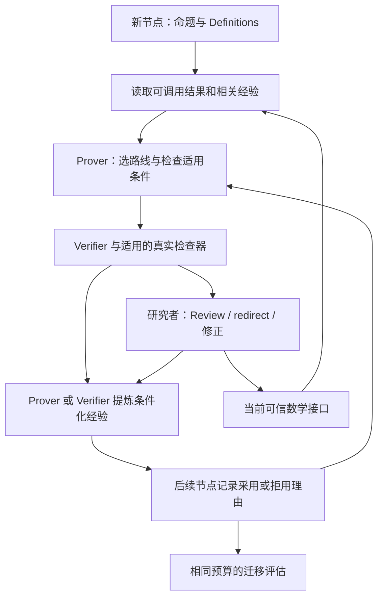

# 让 agent 在同一证明项目中持续改进

日期：2026-10-12。状态：研究与设计建议；没有实施运行时改动，没有调用模型，没有提交 Issue、PR 或 commit。

## 建议

先把已有的经验共享做成可验证的学习循环：**反馈 → 条件化经验 → 下一节点的决策 → 检查实际结果**。

第一版复用 memory、work log、Briefing 和 Human Review。模型参数训练、向量数据库、独立反思角色和自动改写全局策略都不在第一版范围内。

目标是固定模型在这个项目的后续问题上更有效：更少重走失败路线，更准确地使用假设和引理，更快交付可审阅的材料，更少消耗研究者的核对时间。记录更多文字本身不是改进。

## 两层学习：项目为主，全局为基础

用户进一步明确：主要目标是让 agent 在一个具体项目中越来越有效。建议采用两层经验与策略状态。两层可以由同一个模型使用；不要求分别训练两个模型。

| 层 | 保存与学习什么 | 更新方式 | 使用范围 |
| --- | --- | --- | --- |
| 全局层 | 通用工作流程、检查清单、带适用条件的方法经验；例如先检索、检查常数依赖、检查量词与引用 | 低频维护；新的经验先在源项目验证，去掉局部约定，再经其他项目检验和人工确认 | 为各项目提供版本固定的基础 |
| 项目层 | 本项目的 Definitions、归一化、文献解释、可调用结果、失败路线、有效方法、研究者修正与策略选择记录 | 每次有实质反馈时更新；绑定项目和源节点，保留版本与适用条件 | 默认只影响这个项目的后续节点 |

数学结果与方法经验仍按上一节的可信规则分别处理。共享一个通用方法不等于共享其来源项目的 Acceptance；跨项目使用数学结果仍须通过现有引用、导入和审阅规则。

当前节点的 draft、Attempt 和开放 objection 是本轮工作状态，不需要再建立第三套学习系统。读取时，由当前问题决定是否适用；项目明确约定优先于全局启发式。Acceptance 等数学可信规则始终有效。

可以把一次行动表示为：

\[
 a_t \sim \pi_{\theta}(\,\cdot\mid s_t,G_v,M_{p,v},P_{p,v}\,),
\]

其中，\(\theta\) 是基础模型，\(G_v\) 是本次运行固定的全局经验版本，\(M_{p,v}\) 是项目 \(p\) 的经验，\(P_{p,v}\) 是该项目的策略配置，\(s_t\) 是当前节点状态。这是设计记号，不表示我们已经实现或训练了该策略。

### 经验怎样从项目进入全局

先留在源项目。只有抽象后的条件和方法能在其他项目适用，才形成全局候选。核查时保留反例、适用条件和源证据；经人工确认后进入新的全局版本。一个项目中成功几次，不足以自动获得全局规则地位。

例如，项目经验可能是“这里的归一化使某个换算因子依赖 K-type，目标需要一致常数，应先核查该因子”。其全局候选可以是“使用范数换算证明一致估计时，显式检查换算常数的参数依赖”。前者的具体数学断言仍须源证明与 Review；后者是检查建议，不能据此否定其他项目的某条证明。

新项目从固定的全局经验版本开始，形成自己的项目经验。正在运行的项目不随其他项目的反馈自动改写策略。项目经验库只读当前项目；跨项目经验通过明确的全局条目或已有 cross-project retrieval 来源进入，不能无区别合并所有项目记忆。

### 如果需要严格意义的强化学习

更新 memory、检索和文字提示，本身只是经验积累与上下文适应。若要称为强化学习，需要明确定义状态、可选行动、回报，以及根据回报更新策略的过程。

可以将项目级策略优化单独列为后续试验：状态取当前目标、可调用依赖、尚未解决的障碍和剩余预算；行动取提出的搜索路线或下一项检查；回报以研究者确认的正确处理为主要依据，并记录实际模型成本和人工核对时间。自报成功、节点数或候选长度不能代替回报。认证失败等执行问题要分别统计。

这种学习可以发生在项目的路线选择策略上，基础模型保持不变。项目专用参数训练是另一个实现选项，需要足够的已核查轨迹和单独评估，当前材料没有证明它的收益。全局策略训练也需要跨项目证据，不能由一个项目的回报直接更新。

### 对照实验中的两层

固定全局版本 \(G_v\)，先用同一项目的早期问题积累经验，再冻结项目经验版本。对后续问题比较现有系统与改进系统，所有组得到相同的可调用数学结果。每轮比较结束后才能把目标反馈写回下一版本项目经验。

后续可以另加“仅全局经验”组，测量项目经验在已有数学结果之外的增益。它与“改进后的项目经验优于当前项目经验”是不同问题，应分别报告。不能用后期问题更容易、已接受引理更多或预算更大，冒充项目策略学习的收益。

第一版只完善项目层；全局层先复用现有通用角色说明、技能与检查规则。无需先创建独立的全局 memory 数据库。

## 论文能支持什么

EdgeBench 的方法以 ICL 为学习机制。其经验消融比较同一任务中保留工作区、产物和历史的连续执行，与清空状态的独立重启。这个对照支持持续状态有价值；不能单独证明某种记忆格式有效，也没有直接证明经验能迁移到未解决的另一证明节点。[原论文 §5.2、Appendix F.3/G.1](https://arxiv.org/html/2607.05155)

论文的数学任务使用形式化检查。我们的自然语言证明以 Human Review 为最终判断，需要单独测量反馈的可靠性。多任务平均的 best-so-far 曲线不能用来承诺一个研究项目会持续进步。[原论文 Appendix G.4、§3、Appendix D.5](https://arxiv.org/html/2607.05155)

原始证据与官方代码固定版本见 [来源笔记](2026-10-12-project-learning-edgebench-sources.md)。以下机制是我们的设计推论，不是论文已验证的方案。

## 现有基础与实际缺口

源码读取范围：当前 core 工作区，以及已保存的较新候选 core `0c3e1f1`、agents `544a95f`、web `deaa8a9` 的相关源码。当前主工作区与这些候选不同；本文不宣称它们都是当前远端主线或运行中的版本。后续实施需重新固定实际基线。

| 已有能力 | 当前行为 | 本次建议补上的部分 |
| --- | --- | --- |
| Attempt | 记录目标、方法、失败点；也从 failed verdict/stuck note 派生 | 将失败范围、原因与重试条件表达清楚；不能把所有 stuck 当作数学反例 |
| 分层 memory | 已有 failed、tactic、tentative；可绑定节点、Candidate proof、Review | 写出适用条件和来源版本；用已有字段和短文本先验证价值 |
| 跨节点共享 | 读取自身、邻接节点、兄弟节点，再检索其他 memory | 明确检索理由；保留 memory ID；减少相关旧经验被截断的风险 |
| Briefing | 有大小上限；最多展示 12 条 attempts、12 条 shared notes；超限时先删最旧 attempt | 按当前问题、开放 objection 和适用条件选择；不能只按新旧判断价值 |
| 重复模式建议 | 已发现重复 objection 和相似失败点，向研究者建议 redirect | 先确认原因和经验来源；不重复实现停滞检测，不立即增加自动换路线 |
| Human Review | Acceptance 与 Reference review 保留给研究者 | 把具体修正和拒绝理由反馈到后续经验；不让 memory 获得 Acceptance 权限 |

主要实现证据：

- [ADR-0019：Attempt、memory、Briefing 和黑板共享](../adr/0019-the-run-is-a-prove-verify-loop-over-the-map.md)。
- [memory 的现有范围与字段](../../src/proof_cli/memory.py)、[现有 CLI](../../src/proof_cli/cli.py)。
- [retrieve_memory](../../src/proof_cli/retrieval.py)：当前按 content、tags、notes 的词项重合检索；词项正则主要覆盖 ASCII 字母词。数学假设是否等价、常数是否一致，不由该检索判断。
- 已读的候选实现：[Briefing](/private/tmp/proof-paper-followup.JQRMD1/agents/src/proof_agents/briefing.py:28)、[共享读取](/private/tmp/proof-paper-followup.JQRMD1/web/src/proof_web/studios.py:414)、[已有重复模式](/private/tmp/proof-paper-followup.JQRMD1/agents/src/proof_agents/patterns.py:53)。临时目录链接只标识本次读取位置，不作为长期代码来源。

### T8 的只读诊断

保存的主试验运行了 40 次 provider turns，最终有 7 个 Provisional proof nodes，未发生人工 Acceptance 或 Reference review。这是流程交付记录，不能计算数学成功率。[过程报告](2026-10-12-design-followup/t8-process-report.md)

本次用 SQLite `mode=ro` 读取保存的 `real-trial-profile` 数据库，没有通过 ProjectStore 打开或迁移它。发现 12 条 memory：8 条 tactic、3 条 failed、1 条 tentative。其 tags、Candidate proof 链接与 Review 链接都未填。缺少 Candidate proof/Review 链接在尚未产生对应对象时是合法的，不能据此判定这些经验无效。

这些记录已经含有有用的方法和障碍说明。仍需检查它们的适用条件、引用来源、后续采纳和效果。当前数据不能说明哪条经验造成了哪个节点的改善。输入路径、SHA-256 和统计见 [只读诊断](2026-10-12-project-learning-diagnostic.json)。没有独立审定这些 memory 的数学内容。

## 三类积累需要分别处理

| 积累 | 在后续节点中的作用 | 可信依据 |
| --- | --- | --- |
| 数学结果 | 已有引理减少后续证明所需工作 | 当前可调用的 Accepted 节点或经 Reference review / Trusted by rule 的 Imported result；经 proof map 依赖使用 |
| 方法经验 | 指导先尝试什么、检查什么、避开什么条件下的失败 | 原始 Attempt、Verdict、实验或 Review；作为待核查的建议 |
| 研究者反馈 | 明确本项目的定义、目标、允许的假设与偏好的路线 | 研究者实际的修正、redirect、Review；不能把一次局部偏好泛化为全局规则 |

一个节点被 Accepted，可以成为可信数学接口。它使用的方法是否适合另一节点，仍需重新检查。Provisional 依赖沿用现有 Conditional 规则；其未验收的证明文本不能通过 memory 变成可信结果。



图中的反馈异步进行。没有 Human Review 时，agent 可以继续记录待核查的方法经验；这些经验不能自动变成可信事实。

## 第一版具体机制

### 1. 在有新反馈时提炼经验

沿用 Prover / Verifier，不增加反思角色。优先在以下节点提炼一条短经验：

- 某条路线被放弃，且失败可能影响其他节点。
- failed verdict 后发生具体修正，并有检查结果可回指。
- 研究者指出缺失假设、量词变化、引用误用或范围错误。
- 一项方法可帮助其他节点；其数学内容仍按原有规则核查。

不要求每个 turn 都生成摘要。已有相同经验时不重复追加。经验被纠正时保留旧来源，以新的记录说明纠正关系。

先在 `MemoryArtifact.content` 中使用短模板：

```text
适用条件：什么对象、假设、归一化或参数范围下相关。
观察与来源：哪次 Attempt / Verdict / 实验 / Review 报告了什么。
决策建议：在什么情况下尝试、避开或先检查什么。
例外与重试条件：增加哪项假设或新证据后，应重新考虑。
绑定：源节点；有则填 Candidate proof / Review；关键定义与输入版本。
```

复用 `node_id`、`candidate_proof_id`、`review_id`、`source`、`tag` 和 `notes`。尚无 Candidate proof 的失败可回指 work log 的事件、时间和相关文件摘要；不制造一个 Candidate proof 只为填字段。第一版不增加 memory 类型、状态或新数据库。

**经验必须限定失败范围。** “这次没有证明出来”“模型提出 objection”“得到可复核反例”“文献尚未给出所需结论”“执行认证失败”是不同结果。不能统一提炼为“该命题为假”或“该方法无效”。

例如，T8 某条记录报告诱导模型中的范数换算引入了依赖 K-type 的因子。可提炼为：在相关归一化下，先检查换算因子是否满足目标的一致常数要求；只有确认该障碍仍在，才降低直接 sup-norm 路线的优先级。这是待核查的方法建议。具体估计成立与否仍需要源证明和 Review。

### 2. 检索后检查适用性

先复用现有 DAG 邻域与词项检索。补上短 tags、Definitions 标识和方法名称，不先引入 embedding。

选择经验时检查：当前目标与源条件是否对应？定义或归一化是否改变？经验指向的 Candidate proof / Review 是否仍描述源对象？源节点是否已有修正或 Challenge？版本变化时显示“需复核”，不能静默删除历史，也不能继续当作当前适用的结论。

自动程序可以检查 ID、版本和摘要的一致性。它不能判定任意数学假设之间的蕴含。条件匹配不确定时，由本轮 Prover / Verifier 核查。

为与当前开放 objection 直接相关的短经验保留 briefing 空间。保留其 ID、来源和“为什么相关”。不能为了放更多经验而删掉当前命题、必要 Definitions、研究者 redirect 或最新 objection。其余内容沿用现有截断与继续读取机制。

### 3. 记录经验怎样影响行动

复用当前 plan、step 或 handoff 的 note。对实际采用或有疑问的关键经验记录：

```text
memory <id>：采用 / 条件不符 / 需复核。
理由：本节点与经验的哪些条件相同或不同。
行动：改用哪条路线，或先检查哪一个具体步骤。
```

不要让 agent 给每条检索结果打分。只记录影响决策的少量条目。

在共享读取与 Briefing 中保留已有 memory ID；将展示过的 ID 写进现有 turn 记录，可区分“被展示”“被采用”“经检查有帮助”。这些都是诊断数据，不能由自述“有帮助”推导因果收益。

### 4. 将反馈回到原有循环

Verifier 继续给出可定位的 objection。实际数值/符号/形式化检查只报告其检查范围。编译成功、有限数值样例和模型 passed verdict 均不能替代一般命题的证明与 Human Review。

研究者拒绝或修正时，把具体差异回指到相关经验。若依赖成立但方法解释错了，纠正方法记录；若数学接口失效，则走现有 Challenge / re-review 流程。不能让经验清理绕过 proof map 的可信状态。

Decomposer 的替代 Search routes 仍作为选择记录；不把几条替代路线变成父节点同时必须满足的依赖。已有角色约束见 [设计 follow-up](2026-10-12-design-followup/README.md)。

## 怎样检验“越来越好”

证明更多引理和学会更好的搜索方法是两个收益。前者使后续题更容易，不能单独证明 agent 的方法学习更有效。

最小实验比较 **A：当前 harness** 与 **B：上述条件化经验和使用记录**。先用少量早期节点积累经验，冻结经验版本，再测试同项目中尚未给出解答的相关问题。不要让目标问题的证明、反例、评审答案进入经验库。

| 固定项 | 要求 |
| --- | --- |
| 模型与工具 | 固定模型版本、backend、检查器和起始配置 |
| 数学知识 | 两组得到相同 Definitions、References、可调用引理、目标命题和起始 Attempt；可复用的数学产物保持一致 |
| 经验来源 | 两组使用相同的源经验材料；A 用当前表示与读取，B 用条件化表示与读取；新增提炼成本单独计入 |
| 运行状态 | 每个目标独立复制同一冻结状态；组间不共享运行产物；在该轮比较结束前不把目标反馈写回冻结经验 |
| 资源 | 相同总调用/时间上限，并记录实际 token、费用和人工时间；费用上限必须先确定，超限停止 |
| 判读 | 使用同一审阅清单；尽可能让研究者不知道组别；所有 pending / failed / error 分别报告 |

主要衡量：预先固定的目标问题中，研究者确认的正确处理比例，以及每项正确处理的模型成本和人工核对时间。目标可包含需要证明的真命题与需要诊断的错误命题；后者只有研究者核查反例或修正后才算正确处理。新增节点数、模型 passed 次数、候选长度都不是主要成功指标。

次要诊断：重复同一已确认障碍的比例、首个可审阅材料的时间、严重假设/量词/引用错误、经验被展示与被采用的比例、版本改变后误用旧经验的情况。语义重复不能只靠字符串比较计数。

任务数量、重复次数和费用上限需在运行前固定。少量重复只用于探测方向，必须报告逐题结果和差异，不能给出稳定学习定律的结论。本次没有开始实验。

如果要验证“连续状态包 vs 反复重新开始”，另加预算相同的重启组。它回答不同问题，不能替代 B 对当前 A 的增益评估。若要验证哪个机制起效，后续一次只改变经验表示、选择或使用记录中的一个因素。

## 推荐实施顺序

1. 用保存的 12 条经验做离线检查：哪些条件缺失、哪些可定位到来源、哪些可能被后续节点读到。离线回放只能检查接线，不能证明实际模型收益。
2. 在现有 Prover / Verifier brief 中落实经验模板与关键采用理由；不改变它们的权限。
3. 在 shared notes / Briefing 中传递 memory ID，检查相关性和截断；根据已有 scope 字段展示源版本与复核提示。
4. 完成有限预算的 A/B 迁移试验，收集研究者的正确性判断与核对时间。
5. 只有发现明确漏召回或重复错误，再评估更复杂检索、经验排序或工作分配。自动换路线与策略自修改会触及 ADR-0019 的研究者决策边界，需要另作设计决定。

最先要获得的证据是：**相同数学知识、相同预算下，已有经验使后续问题的决策和交付更好。** 在这项证据出现前，不将增加运行时间、扩大上下文或累积 memory 数量称为已经学会。
