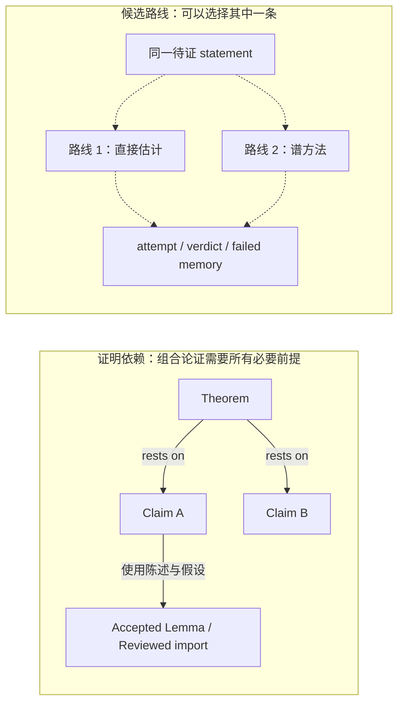

# ScientistOne 与 FML-bench：对 Proof OS 的设计参考

日期：2026-10-12。按研究者反馈修订顺序与衡量目标。本文是研究与设计建议，不是已采纳的 ADR，也不是实现审计。

论文版本：[ScientistOne v1](https://arxiv.org/html/2605.26340v1)，[FML-bench v2](https://arxiv.org/html/2605.17373v2)。用户给出的未定版 FML PDF 本次返回 v2。

系统对照范围：本地 `master` 为 `c259da02f2ddb7c255aecf0db3d5ec2af40bb357`；较新的 ADR-0021/0022 从本地 `integ/0021`（`b7f394374ce73e9a23754e12506e87e97326efd9`）读取。另读取现有 [T8 发布与试验报告](../audits/2026-10-11-integration-published-t8/README.md)。不能把这些集成设计都视为当前 master 的行为。本次没有重跑 T8，也没有复验远端发布状态。

## 判断

最值得借鉴的是两件事：**在生成结论时建立证据关联；在固定执行条件下观察搜索过程，再决定是否换路线。**

我们已有大部分基础：Review snapshot、依赖版本、Verifier、Evidence check、attempt、memory、Provisional、Conditional 和人工 Acceptance。当前目标是**降低每项审阅的核对成本，以人工阅读/核对时间衡量**。先修复已经有证据的执行失败说明与界面缺口，再补最小角色约束，并读取现有轨迹。证据表与换路线机制在报告后再决定。

以下论文摘要描述作者的结果。后面的落地方案是针对 Proof OS 的设计推断，尚未通过数学研究任务验证。

## 本次修订后的工作顺序

| 顺序 | 范围 | 最小改动与验收 |
|---|---|---|
| 1 | T8 两项缺口，关联 core #197 | 复用已有 Reader 失败原因修复与 Definition stale/work log 修复；界面说明失败原因、Definition ID、编辑者与原因；执行失败不作为数学停滞样本 |
| 2 | Decomposer 与 CONTEXT.md | 只分解选定路线的必要 Claims，不把替代路线都变成必需依赖；增加一句 Search route 定义 |
| 3 | proof-agents 的 Verifier | 在已有 Typesetter → Verifier 流程中加入假设、量词/作用域和 Conditional 清单；无需新增 core 流程 |
| 4 | T8 保存轨迹 | 离线生成过程报告，分开原始认证失败、主试验与受控复现；不调用模型 |
| 5 | 报告后的设计判断 | 用人工阅读时间与漏项发现决定证据表的价值；有对照证据后再考虑更早换路线 |

第一步已有修复，不能另起重复实现。本次读取的远端 heads：core #210 `0c3e1f1`、agents #27 `544a95f`、web #22 `f1a58ce`、web #23 `deaa8a9`，均为 OPEN。最新 core/web heads 已补之前审计发现的重复历史扫描与 turn 内编辑者缺失。实际合并后的 #197 验收仍是后续工作，本次没有重跑研究试验或关闭 Issue。

一项计数约定需要明确：认证失败的实际启动仍可消耗总执行预算；停滞诊断则排除该项。零 token 不能单独证明没有数学执行，应同时读取 nonzero exit、is_error 和具体失败原因。这次没有改变预算或增设自动重试。

本次结果见 [落实记录](2026-10-12-design-followup/README.md) 与 [离线过程报告](2026-10-12-design-followup/t8-process-report.md)。

## 两篇论文分别回答什么

| 论文 | 问题 | 方法 | 对我们的直接意义 |
|---|---|---|---|
| ScientistOne: Towards Human-Level Autonomous Research via Chain-of-Evidence | 写出的研究结论能否追到实际来源？ | Chain-of-Evidence；在检索、实验、写作时保留证据关联；对最终产物再审计 | 检查 statement、引用、程序输出与 key-ideas 是否一致 |
| FML-bench: A Controlled Study of AI Research Agent Strategies from the Perspective of Search Dynamics | 搜索策略的复杂度是否带来更好结果？ | 统一编辑与执行环境，比较策略及过程轨迹 | 固定运行基础设施，先测量停滞，再比较重试与换路线 |

来源：[ScientistOne §3–6](https://arxiv.org/html/2605.26340v1)，[FML-bench §3–5](https://arxiv.org/html/2605.17373v2)。

### ScientistOne

CoE 把引用、数值、方法、结论分开检查。流程先检索文献，再搜索与执行，最后根据带来源的中间稿写论文。最终审计检查分数复验、规格违规、引用存在性和方法与代码一致性。其价值在于把来源关联放在生产过程中，并检查写作是否偏离原始产物。[§3–5](https://arxiv.org/html/2605.26340v1)

作者审计了 75 篇产物。ScientistOne 报告虚构引用 0/337、分数复验 12/12、方法与代码一致 14/15。分数复验排除了 3 篇 EPLB，因为评分含硬件相关耗时。引用存在不代表引用支持该陈述，LLM 审计也会漏检；这些结果不能证明数学推导正确。[Table 1、§9](https://arxiv.org/html/2605.26340v1)

### FML-bench

作者在 18 个 ML 任务上统一代码编辑、执行与 validation/test 隔离。六种策略各运行三轮，每轮 100 次 validation 执行。贪心 Autoresearch 的平均归一化改进为 0.192，树搜索 TAS v2 为 0.193。停滞后扩大探索的 AdaptiveSearch 为 0.208。这支持把简单策略作为起点，但尚不能证明复杂策略在数学任务中无用。[§3–4、Table 2–3](https://arxiv.org/html/2605.17373v2)

需保留三项限制：同 step 数不等于同 token/时间成本；部分任务的归一化尺度不同；过程指标的相关性不是因果。AdaptiveSearch 的停滞切换信号可在线计算，但后续几何引导用主实验轨迹校准，不能直接用于陌生任务。实验还移除了原系统的检索等辅助模块，比较的是移植后的策略。[§6、Appendix C–E](https://arxiv.org/html/2605.17373v2)

## 我们已有的设计与需要补强的地方

| 参考思想 | 已有基础 | 建议的最小增量 | 边界 |
|---|---|---|---|
| 在产物生成时绑定证据 | Review snapshot、SHA-256、依赖 pins、key-ideas | 先观察研究者找来源的成本；只补报告反复暴露的关联需求 | 字段覆盖只作诊断，阅读时间是主要收益指标 |
| 引用核对到具体内容 | Imported result 的 source locator/version、Reference review | Reader 给出定理号或页码，列出转述时改变的假设；Verifier 明示未读原文 | DOI 存在、来源已被审阅，都不能批准 agent 的新转述 |
| 写作后再次核对 | Typesetter 后重新调用 Verifier；summary 随 snapshot 冻结 | 检查 summary 是否遗漏假设、改变量词、掩盖 Conditional 或使用错版本 | 检查报告不能替代 Acceptance |
| 停滞后换路线 | attempt、failed memory、重复 objection 提示、Parked 后再分解 | 先修复执行失败说明，再从保存轨迹判断是否需要更广的停滞报告 | 不把基础设施失败误判为数学停滞 |
| 策略与执行分开 | ADR-0018 四包、RunHooks | 在同一执行环境上比较调度策略；不同时更换模型、权限或 checker | 同 turn 数仍需报告成本差异 |
| 过程评估 | work log、verdict、review queue、Pursue 历史 | 从已有记录派生首个有效交付时间、重复失败、失效返工与审阅负担 | 节点数和 passing verdict 数不是数学成功率 |

系统依据：[ADR-0004](../adr/0004-only-human-review-changes-acceptance.md)、[ADR-0013](../adr/0013-review-snapshots-carry-a-key-ideas-summary.md)、[ADR-0015](../adr/0015-medium-and-the-computation-studio.md)、[ADR-0018](../adr/0018-four-packages.md)、[ADR-0019](../adr/0019-the-run-is-a-prove-verify-loop-over-the-map.md)，以及本地 `integ/0021` 的 ADR-0021/0022。表中的增量都是建议，不是已确认的缺陷。

## 后续候选：以减少核对时间为目标的证据关联

每项再增加一张表可能增加审阅负担。以下关联表只作为候选方案，在离线报告之后再决定是否需要。可先复用现有 summary 与 notes，按需呈现来源；不能把信息更多视为阅读成本更低。

| 要核对的内容 | 应看到的来源 | 可以自动做的检查 | 仍需研究者判断 |
|---|---|---|---|
| 一个关键证明步骤 | 本 snapshot 的证明位置；依赖节点及 pin | ID/文件是否存在、版本是否匹配、是否 Conditional | 依赖的陈述是否足以推出该步，假设是否满足 |
| 一个 imported result 的陈述 | 来源版本、页码/定理号；Reader 的转述与 departure | 书目是否存在、locator 是否完整、是否尚未核对原文 | 原文是否真的支持转述 |
| 一个数值结论 | 同一次执行的输入、输出文件、指标定义与运行记录 | 文件/哈希是否匹配、指标单位和方向是否一致 | 数值计算的误差、覆盖范围和数学意义 |
| 一条 key-ideas 陈述 | 同一 snapshot 的证明及其依赖 | 是否引用错节点或旧 snapshot | 是否省略必要假设、把局部结果写成一般结论 |

最小版本先复用 `key-ideas.md` 的“主要步骤”与“未覆盖”，以及 Evidence check 的 notes。无需立刻建立新的四类 claim 表，也无需为每一句证明建一个 proof map node。只有使用报告反复暴露出结构化需求，才增加字段。

排版或导出可以隐藏阅读用的证据标记，但绑定记录应继续随冻结产物保存。否则研究者看到的是整洁文本，复验时却失去了它指向的来源。这里建议保留关联的做法，不要求修改既有 snapshot 格式。

Verifier 的产物继续是建议。对未写完的草稿，关联不完整可以显示为待核对；不能因此重新引入每一步都等研究者的进度门禁。人工请求 Review 仍保留现有权限。补强目标是让 Acceptance 的材料更清楚，而不是让自动审计取得 Acceptance 权力。

数学例子：Imported result 给出“在 $X$ 紧且 $f$ 连续时，$f$ 取得极值”。依赖此结果的 Claim 在非紧 $X$ 上调用它，引用可能真实、locator 可能正确、依赖 pin 也可能匹配，但推导仍不成立。因此我们需要核对假设与应用，而不只核对来源存在。

### 计算结果尤其需要区分两种检查

ADR-0015 的 Run Evidence 说明冻结输入在本机的执行结果。它允许重跑输出不同于 snapshot 的 `out/`，所以 **exit 0 不认证原来冻结的输出**。

若一个 summary 写“枚举了全部 $10^6$ 个实例，未发现反例”，建议另有检查报告核对：实例范围、计数、输出解析、异常处理和 summary 是否来自同一次执行。环境记录只保存可公开复验的版本与参数；不冻结凭据或秘密环境变量。对随机或数值计算，容差、种子及误差说明由具体任务给出，不能照搬 ScientistOne 的评分容差。

新检查仍绑定具体 Candidate proof，作为 Evidence check 或 verifier note 保存。它回答“报告与产物是否一致”，不会把实验观察自动变成定理。Proof fog 的 Experiment 继续留在探索层，不因关联齐全就升级成 Evidence check。

## 后续候选：诊断数学停滞与受限换路线

建议保留现有 Prover → Verifier 修正循环。先从记录里区分以下原因：

| 观察 | 合理行动 | 不应推断 |
|---|---|---|
| 同一 objection 在可比的输入/假设下反复出现 | 把旧 attempt 与本轮计划并列，要求说明路线改变了什么 | 文案不同就一定换了数学方法 |
| 某个依赖缺失或未成为 Provisional | 检索可复用结果，或明确缺失的 Claim/Fog | 再润色当前证明能消除缺失前提 |
| 当前 statement 出现无法满足的假设或矛盾 | 留下具体 objection/Standing question，按现有 needs-human 规则处理 | 搜索失败已经证明原 statement 为假 |
| provider、认证、日志保存或程序启动失败 | 报告执行问题，保留结果未知的状态 | 没有新结果说明数学路线停滞 |

复用 ADR-0019 已有的重复 objection 提示与 failed memory。ADR-0021 已允许 Parked Claim 的 parent 再做一次 Decomposer turn，可以先用这个受限机制作对照。暂不增加任意自动改写结构。

若以后要在预算耗尽前自动改变路线，应先修改对应调度决策，明确触发原因、一次 Start 内的次数上限、剩余额度和停止条件。ADR-0019 的旧“只建议 redirect”不能被静默扩大为任意自动调度权。

停滞窗口应按完成的数学尝试计数，并记录无效执行与耗时。输入、假设或依赖改变后，旧 observation 不一定可比。新增节点、改写文字和再次调用同一失败路线，都不能单独算进展。我们没有类似 validation accuracy 的可靠连续目标，所以暂不引入证明质量 reward 或 UCT。

## 必须分清：证明依赖与可选搜索路线

如果把两条可选路线都用 Split 加为父节点的依赖，父节点就会等待两者，而不是择一成功。搜索轨迹先保存在已有 attempts、工作文件和 memory；确有必要建立独立可审阅的辅助 Claim 时，再加入 DAG。替换依赖仍是一次明确、记录在案的结构变更。

这个约束优先进入 Decomposer 的共用角色说明，使单独运行和 Pursue 都能读到；CONTEXT.md 只增加一句定义。Decomposer 的权限不扩大：路线备注用已有 scratch/、Standing question 和 attempt；不新增写 memory 的权限。

`Provisional` 允许工作条件性地使用 statement。它不允许复用未接受的 proof text，也不允许最终 Accepted 节点保留未接受前提。搜索路线的胜出只能决定“下一步试什么”，不能决定“什么已经成立”。

## 离线过程与审阅成本报告

近期 T8 报告已经说明为什么只看运行完成不够：40 turns、87.6 分钟、7 个 Provisional proof nodes，但 Theorem 结果为 stuck，没有人工 Acceptance 或 Reference review；Review queue 有 68 项。这是有用的候选工作和故障定位材料，不能当作定理成功率。这里只引用已保存报告，未在本次重跑。[T8 结果](../audits/2026-10-11-integration-published-t8/README.md)

建议第一版报告从已有事件派生，不新增数据库或 embedding 服务：

| 指标 | 定义/用途 | 限制 |
|---|---|---|
| 首个可审阅交付时间 | 首次形成当前 snapshot 且有匹配 passing Verifier check 的时间 | 只是流程交付，不是数学正确性 |
| 重复失败次数 | 同一障碍在可比状态下再次出现的次数 | 保留匹配规则及原始文本，允许人工否认相似性 |
| 失效与返工 | statement/Definition/依赖变动后受影响的 snapshots 与再次工作量 | 不把正常探索全部算成浪费 |
| 来源核对覆盖（诊断项） | 明确已读原文的 imports、尚未核对的 imports，以及具体 locator | 已读不等于已批准；覆盖率不是审阅成本目标 |
| 研究者审阅成本 | queue 的组成、主要审阅问题；人工阅读/修改时间 | 当前不一定有时间数据，缺项标未知 |
| 资源与停止原因 | 实际调用、可观测 token、turn、structure turn、耗时、error/parked/stuck | 未观测费用不能估成零，结构工作也消耗总预算 |
| 数学结果 | 研究者盲审后的 Accepted/需修订/Rejected，以及最终 Theorem 状态 | 独立于循环 done、provider exit 与 Verifier pass |

不把 FML 的代码 embedding 距离用作证明路线多样性；不把 AUC、节点数、summary 长度或 passing verdict 数作为 agent 的优化目标。它们容易奖励表面产出，且还没有数学任务上的有效性证据。

本次 [离线报告](2026-10-12-design-followup/t8-process-report.md) 已细分 68 项：24 个未固定 statement、15 个 Definition、10 个引用、7 个 Provisional、9 个问题、3 个 Parked。首个 Review 请求为 15.25 分钟，但该节点最后不再 Provisional；最早请求且最终仍为 Provisional 的节点为 26.05 分钟。阅读时间没有记录，保持未知，因此本次不据此引入证据表或提前换路线机制。

## 如何验证这些建议

先用已有 T8 与其他保存轨迹做离线报告和人工抽样，确认日志能回答实际审阅问题。此阶段不需要额外模型调用。

若要做有成本的对照试验，建议分两次，每次只改一个因素：

1. **核对成本对照**：对同一冻结材料使用现有界面与最小来源呈现。首先比较人工阅读/核对时间，同时记录漏假设、错引用、错输出和过时依赖的发现情况；不以字段覆盖率验收。
2. **搜索策略对照**：现有重试/受限再分解 vs 根据停滞报告切换路线。模型、权限、checker、briefing 基础和输入相同。任务按直接证明、缺失引理、错误假设、计算证明分组，分别报告结果。

试验开始前固定样本、重复次数、总成本与停止条件。一个逻辑尝试可能含多个角色 turn，所以同时报告尝试数、所有 provider 调用和实际成本。保留 failed/error/stale，而不是只保留最好的一次。

最终人工评估者只读匿名化的冻结产物与依赖材料。用于制定停滞规则的题目和轨迹不能同时当作独立验证；另留任务检验。这里借鉴的是 validation/test 隔离的原则，不是声称数学证明也有同样的数值测试集。

## 取舍与建议顺序

1. **先接续 T8 两项缺口的修复。** 复用 #197 的现有工作，分开执行失败与数学停滞，说明已保存的修改。
2. **固化路线约束。** Decomposer 只为选定路线建立必要依赖，CONTEXT.md 定义 Search route。
3. **加入终稿清单。** 复用已有 Verifier turn，主要修改角色提示，不增加 core 状态或流程。
4. **生成离线过程报告。** 只读取保存轨迹，标明未知阅读时间，不调用模型。
5. **据报告再决定。** 保留“报告反复暴露需求才加字段”的原则；验证阅读收益后再考虑证据表，有搜索对照证据后再扩大换路线机制。

不采纳自动 Acceptance、自动信任 agent 转述、用执行成功认证冻结输出、把可选路线变成必需依赖，或把所有错误都交给无限重试。这些做法会削弱现有信任边界，或缺少本任务上的收益证据。

完整论文事实核对见 [论文证据笔记](2026-10-12-scientistone-fmlbench-paper-evidence.md)。
